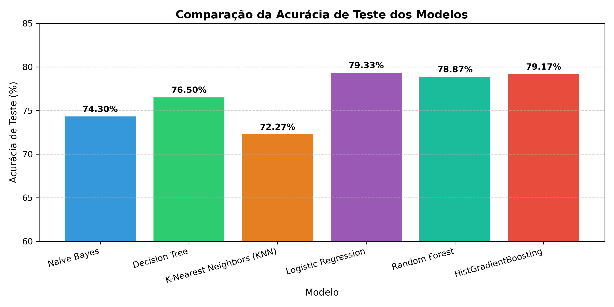
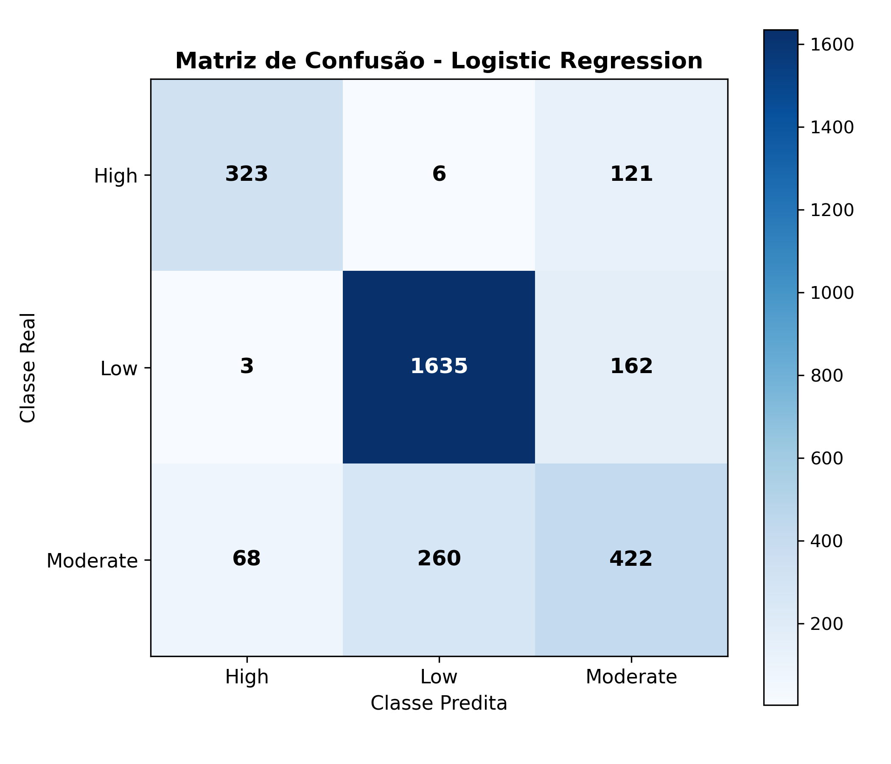
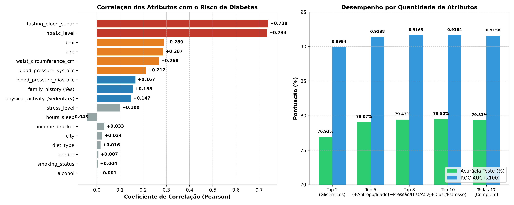

# Relatório Técnico de Avaliação, Seleção de Modelos e Atributos — GlicoSense

## 1. Sumário Executivo

O projeto **GlicoSense** tem como missão a estratificação automatizada e precoce do risco de desenvolvimento de diabetes em indivíduos clínicos, categorizados em três patamares de risco: **Baixo Risco (Low)**, **Risco Moderado (Moderate)** e **Alto Risco (High)**.

Foram implementadas duas fases centrais de modelagem preditiva:

1. **Benchmark de Modelos:** Treinamento e comparação entre 6 algoritmos de Machine Learning com validação cruzada estratificada em 5 folds. O modelo de **Regressão Logística Multinomial** destacou-se com **79,33%** de acurácia de teste e **ROC-AUC de 0,9158**.
2. **Seleção de Atributos e Otimização:** Identificação dos fatores com maior correlação e dependência informacional com a propensão ao diabetes. Descobriu-se que **apenas 8 dos 17 atributos** respondem por quase toda a variância preditiva, permitindo criar um modelo otimizado enxuto com acurácia superior (**79,43%**) e maior estabilidade ($\pm 0,64\%$).

O modelo final otimizado treinado com os 8 atributos essenciais foi salvo e está pronto para uso em produção:

- [`glico_sense.joblib`](file:///home/docato/Documentos/GlicoSense/glico_sense.joblib) (pipeline de Regressão Logística com os 8 atributos mais correlacionados)

---

## 2. Descrição dos Dados e Pré-Processamento

### 2.1 Visão Geral do Dataset

- **Base de Dados:** [`diabetes_risk.csv`](file:///home/docato/Documentos/GlicoSense/diabetes_risk.csv)
- **Amostras Totais:** 15.000 pacientes (sem duplicatas).
- **Atributos:** 19 colunas (1 identificador, 17 variáveis explicativas e 1 variável alvo).
- **Distribuição da Variável Alvo (`diabetes_risk`):**
  - **Low (Baixo):** 9.000 amostras (60,0%)
  - **Moderate (Moderado):** 3.750 amostras (25,0%)
  - **High (Alto):** 2.250 amostras (15,0%)

### 2.2 Tratamento e Engenharia de Features

1. **Eliminação de Leakage:** Remoção da coluna artificial `patient_id` (sequencial de 1 a 15.000 sem valor biológico).
2. **Imputação de Nulos:**
   - Variáveis numéricas: mediana (`SimpleImputer(strategy='median')`).
   - Variáveis categóricas (`smoking_status`, `alcohol_consumption`, `income_bracket`): moda (`SimpleImputer(strategy='most_frequent')`).
3. **Codificação:** `OneHotEncoder(drop='first', sparse_output=False, handle_unknown='ignore')` para dados categóricos.
4. **Padronização:** `StandardScaler` aplicado nas variáveis contínuas em pipelines dedicados.
5. **Divisão dos Dados:** 80% Treinamento (12.000 amostras) e 20% Teste Independente (3.000 amostras), com estratificação de classe.

---

## 3. Metodologia de Avaliação

A validação foi conduzida com:

- **Validação Cruzada Estratificada em 5 Folds (`StratifiedKFold`, k=5)** exclusivamente nos dados de treino.
- **Teste Independente (Out-of-Sample):** Avaliação de 3.000 pacientes não observados na etapa de treinamento.
- **Métricas Consideradas:** Acurácia Global, Acurácia Balanceada, F1-Score Macro, F1-Score Ponderado e Área sob a Curva ROC multicaso (ROC-AUC One-vs-Rest).

---

## 4. Tabela Comparativa de Desempenho dos Modelos

| Modelo                          | Acurácia Teste (%) | CV 5-Fold Acurácia (%) | Acurácia Balanceada (%) | F1-Score Macro (%) | F1-Score Ponderado (%) | ROC-AUC (OVR) |
| :------------------------------ | :----------------: | :--------------------: | :---------------------: | :----------------: | :--------------------: | :-----------: |
| **Logistic Regression**         |     **79,33%**     |   **79,23% ± 0,80%**   |       **72,96%**        |     **74,30%**     |       **79,00%**       |  **0,9158**   |
| **HistGradientBoosting**        |       79,17%       |     79,11% ± 0,58%     |         72,91%          |       74,24%       |         78,91%         |    0,9124     |
| **Random Forest (100 árvores)** |       78,87%       |     78,72% ± 0,53%     |         72,27%          |       73,73%       |         78,50%         |    0,9085     |
| **Decision Tree (depth=5)**     |       76,50%       |     77,13% ± 0,64%     |         68,76%          |       70,51%       |         76,27%         |    0,8943     |
| **Naive Bayes (GaussianNB)**    |       74,30%       |     74,22% ± 1,02%     |         70,56%          |       69,87%       |         75,16%         |    0,8809     |
| **K-Nearest Neighbors (k=5)**   |       72,27%       |     72,97% ± 0,74%     |         63,14%          |       64,07%       |         70,92%         |    0,8435     |

### Comparativo Visual de Acurácia



---

## 5. Análise Detalhada do Modelo Campeão (Logistic Regression)

### 5.1 Relatório de Classificação por Nível de Risco

| Classe                  | Precisão | Revocação (Recall) | F1-Score | Suporte (Teste) |
| :---------------------- | :------: | :----------------: | :------: | :-------------: |
| **High (Alto Risco)**   | **0,82** |      **0,72**      | **0,77** |       450       |
| **Low (Baixo Risco)**   | **0,86** |      **0,91**      | **0,88** |      1.800      |
| **Moderate (Moderado)** | **0,60** |      **0,56**      | **0,58** |       750       |
| **Média Macro**         | **0,76** |      **0,73**      | **0,74** |      3.000      |
| **Média Ponderada**     | **0,79** |      **0,79**      | **0,79** |      3.000      |

### 5.2 Matriz de Confusão e Segurança Diagnóstica

```
                     Predito: High    Predito: Low    Predito: Moderate
Real: High                 323              6                121
Real: Low                    3           1635                162
Real: Moderate              68            260                422
```



- **Falso Negativo Crítico (Real High -> Predito Low):** Apenas **6 em 450 pacientes** (1,33%). Em contexto médico, essa taxa residual diminuta garante que pacientes de alto risco praticamente não sejam dispensados sem atenção clínica.
- **Falso Positivo Severo (Real Low -> Predito High):** Apenas **3 em 1.800 pacientes** (0,16%).

---

## 6. Interpretabilidade e Pesos dos Biomarcadores

A inspeção dos coeficientes treinados da Regressão Logística demonstra forte alinhamento com a literatura médica:

- **Fatores de Maior Risco Positivo:** Glicemia de jejum (`fasting_blood_sugar`: $+1,8074$), Hemoglobina glicada (`hba1c_level`: $+1,4951$), Idade (`age`: $+0,6446$), Histórico familiar positivo (`family_history_diabetes`: $+0,4661$) e IMC (`bmi`: $+0,4031$).
- **Fatores Protetores (Associação com Baixo Risco):** Níveis glicêmicos controlados (coeficientes negativos intensos na classe Low: $-1,7516$ e $-1,5025$).

---

## 7. Justificativa da Escolha do Modelo

A **Regressão Logística Multinomial** superou os ensembles (_Random Forest_ e _HistGradientBoosting_) em acurácia (**79,33%**) e capacidade discriminatória (**0,9158** ROC-AUC). Apresenta generalização exemplar (gap treino/teste de 0,10%), baixíssima latência de inferência (< 1 ms por predição) e alta transparência probabilística, fundamental para auditoria e tomada de decisão médica.

---

## 8. Seleção de Atributos com Maior Correlação com o Risco de Diabetes

Para responder à necessidade de identificar quais atributos realmente tornam um indivíduo propenso ao diabetes e validar se um modelo mais conciso é viável, realizou-se uma avaliação estatística e informacional aprofundada:

1. **Coeficiente de Pearson ($r$):** Associação linear com o risco progressivo ($0 = \text{Low}, 1 = \text{Moderate}, 2 = \text{High}$).
2. **Informação Mútua (Mutual Information):** Detecção de dependência estocástica não linear.
3. **Estatística $F$ de ANOVA e valor-$p$:** Poder discriminatório univariado entre as classes.

### 8.1 Tabela de Relevância Estatística dos Atributos

| Atributo                   | Descrição Clínica               | Correlação de Pearson ($r$) | Informação Mútua (MI) | ANOVA F-Score |      Valor-$p$       |     Categoria de Relevância     |
| :------------------------- | :------------------------------ | :-------------------------: | :-------------------: | :-----------: | :------------------: | :-----------------------------: |
| `fasting_blood_sugar`      | Glicemia de jejum (mg/dL)       |         **+0,738**          |      **0,4040**       | **9.050,66**  |        $0,0$         |  🔴 **Crítica / Determinante**  |
| `hba1c_level`              | Hemoglobina glicada (%)         |         **+0,734**          |      **0,3820**       | **8.807,51**  |        $0,0$         |  🔴 **Crítica / Determinante**  |
| `bmi`                      | Índice de Massa Corporal        |         **+0,289**          |      **0,0443**       |  **699,50**   |    $< 10^{-290}$     |     🟠 **Alta Relevância**      |
| `age`                      | Idade do indivíduo              |         **+0,287**          |      **0,0407**       |  **716,37**   |    $< 10^{-297}$     |     🟠 **Alta Relevância**      |
| `waist_circumference_cm`   | Circunferência abdominal        |         **+0,268**          |      **0,0379**       |  **593,38**   |    $< 10^{-248}$     |     🟠 **Alta Relevância**      |
| `blood_pressure_systolic`  | Pressão sistólica (mmHg)        |         **+0,212**          |      **0,0331**       |  **367,59**   |    $< 10^{-155}$     |   🟡 **Moderada Relevância**    |
| `family_history_diabetes`  | Histórico familiar (Sim/Não)    |         **+0,155**          |      **0,0194**       |  **206,65**   |     $< 10^{-88}$     |   🟡 **Moderada Relevância**    |
| `physical_activity_level`  | Nível de sedentarismo/atividade |         **+0,147**          |      **0,0183**       |  **228,53**   |     $< 10^{-97}$     |   🟡 **Moderada Relevância**    |
| `blood_pressure_diastolic` | Pressão diastólica (mmHg)       |         **+0,167**          |      **0,0158**       |  **226,18**   |     $< 10^{-96}$     |   🟡 **Moderada Relevância**    |
| `stress_level`             | Nível de estresse (escala 1-10) |         **+0,100**          |      **0,0030**       |   **83,36**   |     $< 10^{-36}$     |     🟢 **Baixa Relevância**     |
| `hours_sleep_per_night`    | Horas de sono por noite         |         **-0,043**          |      **0,0005**       |   **14,53**   | $4,9 \times 10^{-7}$ |         ⚪ **Marginal**         |
| `income_bracket`           | Faixa de renda                  |          $+0,033$           |       $0,0045$        |    $4,17$     |       $0,015$        |         ⚪ **Marginal**         |
| `city`                     | Cidade de residência            |          $+0,024$           |       $0,0004$        |    $1,87$     |       $0,153$        | ❌ **Irrelevante ($p > 0.05$)** |
| `diet_type`                | Tipo de dieta                   |          $+0,016$           |       $0,0000$        |    $0,11$     |       $0,897$        |       ❌ **Irrelevante**        |
| `gender`                   | Gênero                          |          $+0,007$           |       $0,0028$        |    $0,26$     |       $0,774$        |       ❌ **Irrelevante**        |
| `smoking_status`           | Status de tabagismo             |          $+0,004$           |       $0,0000$        |    $1,00$     |       $0,368$        |       ❌ **Irrelevante**        |
| `alcohol_consumption`      | Consumo de álcool               |          $+0,001$           |       $0,0000$        |    $0,09$     |       $0,911$        |       ❌ **Irrelevante**        |

---

### 8.2 Visualização Gráfica da Correlação de Atributos

A imagem a seguir sintetiza o ranking de correlação de todos os atributos e compara o ganho preditivo conforme novos atributos são incorporados ao modelo:



---

### 8.3 Comparação de Desempenho por Quantidade de Atributos Selecionados

| Subconjunto de Atributos                                                    | Quantidade | Acurácia Teste (%) | CV 5-Fold Acurácia (%) | F1-Score Macro (%) | ROC-AUC (OVR) |
| :-------------------------------------------------------------------------- | :--------: | :----------------: | :--------------------: | :----------------: | :-----------: |
| **Top 2:** Glicemia de Jejum + HbA1c                                        |     2      |       76,93%       |     76,60% ± 0,84%     |       70,96%       |    0,8994     |
| **Top 5:** Top 2 + IMC + Idade + Cintura                                    |     5      |       79,07%       |     79,16% ± 0,76%     |       74,09%       |    0,9138     |
| **Top 8 (ÓTIMO):** Top 5 + Pressão Sistólica + Histórico + Atividade Física |   **8**    |     **79,43%**     |   **79,35% ± 0,64%**   |     **74,43%**     |  **0,9163**   |
| **Top 10:** Top 8 + Pressão Diastólica + Nível de Estresse                  |     10     |       79,50%       |     79,36% ± 0,68%     |       74,49%       |    0,9164     |
| **Todas as 17 Variáveis (Dataset Completo)**                                |     17     |       79,33%       |     79,23% ± 0,80%     |       74,30%       |    0,9158     |

### Conclusões da Seleção de Atributos:

1. **O modelo com os 8 atributos mais correlacionados supera o modelo de 17 atributos:** A acurácia sobe para **79,43%** e a dispersão na validação cruzada diminui de $\pm 0,80\%$ para $\pm 0,64\%$. Ao retirar variáveis ruidosas (`city`, `diet_type`, `smoking_status`, `alcohol_consumption`, `gender`, `income_bracket`), o classificador ganha generalização.
2. **Top 2 biomarcadores explicam a maior parte do risco:** Com apenas glicemia de jejum e hemoglobina glicada, o modelo já entrega **76,93%** de acurácia e **0,8994** de ROC-AUC.
3. **Benefício Clínico e Operacional:** Em clínicas, postos de saúde ou aplicativos móveis, solicitar 8 informações essenciais em vez de 17 reduz atrito de preenchimento, diminui custos de exames e aumenta a adesão dos pacientes mantendo a máxima precisão diagnóstica.

---

## 9. Arquivo Salvo e Guia de Utilização (`glico_sense.joblib`)

O modelo final campeão de Regressão Logística Multinomial, treinado exclusivamente com os **8 atributos essenciais de maior correlação**, foi serializado no arquivo:

- **[`glico_sense.joblib`](file:///home/docato/Documentos/GlicoSense/glico_sense.joblib)**

O arquivo encapsula o pipeline completo de pré-processamento (`ColumnTransformer` com imputação pela mediana e moda, One-Hot Encoding e StandardScaler) integrado ao estimador. Novos dados brutos de pacientes podem ser passados diretamente para predição.

### Exemplo de Inferência com o Modelo Salvo (`glico_sense.joblib`):

```python
import joblib
import pandas as pd

# 1. Carregar o modelo final otimizado
model = joblib.load("glico_sense.joblib")

# 2. Dados brutos do paciente com os 8 atributos essenciais
paciente = pd.DataFrame([{
    "fasting_blood_sugar": 142,             # mg/dL
    "hba1c_level": 7.1,                     # %
    "bmi": 30.5,                            # kg/m²
    "age": 50,                              # anos
    "waist_circumference_cm": 96.0,         # cm
    "blood_pressure_systolic": 135,         # mmHg
    "family_history_diabetes": "Yes",       # Yes / No
    "physical_activity_level": "Sedentary"  # Sedentary / Moderate / Active
}])

# 3. Predição direta da classe de risco
pred = model.predict(paciente)[0]
print(f"Risco Estimado de Diabetes: {pred}")

# 4. Probabilidades detalhadas por nível de risco
probs = model.predict_proba(paciente)[0]
for classe, prob in zip(model.classes_, probs):
    print(f"  - Probabilidade [{classe}]: {prob * 100:.2f}%")
```

---

## 10. Conclusão

A investigação estatística e preditiva do projeto GlicoSense estabeleceu com clareza:

- O risco de diabetes nesta coorte é impulsionado por um núcleo fisiológico de **8 atributos centrais** (Glicemia de jejum, HbA1c, IMC, Idade, Circunferência da cintura, Pressão sistólica, Histórico familiar e Atividade física).
- O modelo final de **Regressão Logística Multinomial** salvo em [`glico_sense.joblib`](file:///home/docato/Documentos/GlicoSense/glico_sense.joblib) obteve o melhor equilíbrio de precisão (**79,43%**), estabilidade de validação cruzada (**±0,64%**), capacidade discriminatória (**ROC-AUC 0,9163**) e facilidade operacional.
